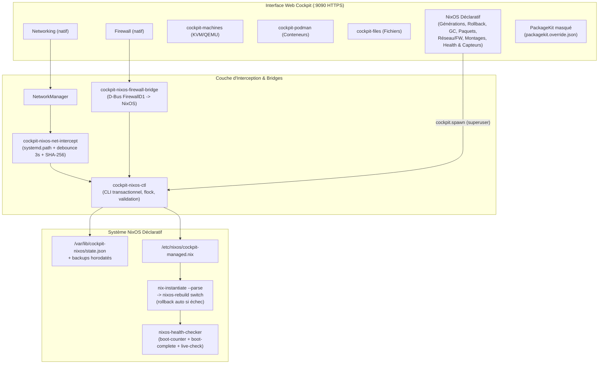

# nixos-steamdeck-cockpit


Un module NixOS et un plugin **Cockpit** qui rendent l'écosystème Cockpit (`cockpit-machines`, `cockpit-files`, `cockpit-podman`, réseau, pare-feu, paquets et générations) **100 % natif et déclaratif** sur NixOS, accompagné d'un **health-checker avec rollback automatique** (inspiré d'openSUSE MicroOS) et d'un profil clé en main pour transformer un **Steam Deck** (ou n'importe quel serveur NixOS) en serveur domestique autonome.

---

## Fonctionnalités

- **Plugin Cockpit « NixOS Déclaratif »** intégré directement dans la barre latérale de Cockpit :
  - Liste des générations NixOS, bascule atomique, **Rollback** en un clic, **`nix-collect-garbage -d`** et optimisation du store (`nix-store --optimise`) avec logs en temps réel.
  - Gestion déclarative des **paquets Nix** (recherche dans `nixpkgs`, ajout/suppression), du **pare-feu**, du **réseau** et des **montages `fileSystems`** pour `cockpit-files`.
  - Suivi en direct de l'état du **Health-Checker**, des mises à jour automatiques et de la **télémétrie matérielle (`hwmon` / ventilateur & APU)**.
- **Interception déclarative vers `/etc/nixos/cockpit-managed.nix`** :
  - **Réseau** : surveille les modifications faites dans l'onglet natif *Networking* de Cockpit (`NetworkManager`) et les synchronise dans `networking.networkmanager.ensureProfiles.profiles` (avec debounce, anti-boucle SHA-256 et filtrage des interfaces éphémères Podman/Libvirt).
  - **Pare-feu** : expose un bridge D-Bus léger (`org.fedoraproject.FirewallD1`) permettant d'utiliser l'interface *Firewall* de Cockpit tout en conservant le pare-feu natif NixOS (`networking.firewall`).
  - **Paquets** : masque l'onglet `PackageKit` (incompatible NixOS) via `override.json` et centralise toute installation dans `environment.systemPackages`.
- **Écosystème virtualisation & stockage complet** :
  - **Podman** (`cockpit-podman`, `dockerCompat`, `dockerSocket`, DNS interne, `podman-compose`, `autoPrune`).
  - **KVM / QEMU** (`cockpit-machines`, `libvirtd`, `libvirt-dbus`, `virt-manager`, `swtpm`).
  - **Fichiers & disques** (`cockpit-files`, `udisks2`, répertoires `/srv/data`, `/srv/shares`, `/mnt/storage` prêts à l'emploi).
- **Mises à jour automatiques & Auto-Rollback (style openSUSE MicroOS)** :
  - Mises à jour nocturnes (`system.autoUpgrade`) avec fenêtre de redémarrage dédiée (`03:00`–`05:30`) et `nix.gc` conservant les 14 derniers jours.
  - Protection 3 niveaux : watchdog matériel + `panic=10`, `systemd-boot` `bootCounting` (si disponible), compteur précoce anti boot-loop et sondes de santé bloquant `boot-complete.target`. En cas d'échecs répétés sur une nouvelle génération, le serveur revient automatiquement sur la dernière génération saine (`last_good_gen`).
- **Profil Serveur Steam Deck (via Jovian-NixOS)** :
  - Noyau Valve Neptune incluant les drivers `steamdeck` / `steamdeck_hwmon` et la gestion du ventilateur `jupiter-fan-control` (plus une courbe ventilateur serveur 24/7 optionnelle).
  - Mode serveur headless (`jovian.steam.enable = false`, anti-veille, extinction d'écran `consoleblank=60` anti burn-in OLED).

---

## Démarrage rapide

### Prérequis recommandé
Utilisez le canal **`nixos-unstable`** (recommandé pour `Jovian-NixOS` et `cockpit-files`) :
```bash
sudo nix-channel --add https://nixos.org/channels/nixos-unstable nixos
sudo nix-channel --update
```

### Option A — Profil complet Serveur Steam Deck (1 ligne dans `configuration.nix`)

Ajoutez cet import dans votre `/etc/nixos/configuration.nix` existant :

```nix
{ config, pkgs, ... }:

{
  imports = [
    ./hardware-configuration.nix
    (builtins.fetchTarball "https://github.com/benjamin7490/nixos-steamdeck-cockpit/archive/main.tar.gz")
  ];

  # Donne automatiquement les groupes wheel, networkmanager et libvirtd à votre utilisateur
  services.steamdeck-server.adminUsers = [ "<votre-utilisateur>" ];

  # Optionnel : activer SSH si besoin
  # services.openssh.enable = true;

  # Optionnel : courbe ventilateur serveur 24/7 plus fraîche que jupiter-fan-control
  # services.steamdeck-server.enableCustomFanCurve = true;
}
```

Appliquez la configuration puis redémarrez une fois pour activer le noyau Valve Neptune (`steamdeck_hwmon`) :
```bash
sudo nixos-rebuild switch
sudo reboot
```

### Option B — Serveur NixOS générique (sans drivers Steam Deck / Jovian)

Importez uniquement le module générique `nixos/cockpit-nixos-module.nix` :

```nix
{ config, pkgs, lib, ... }:

{
  imports = [
    ./hardware-configuration.nix
    ((builtins.fetchTarball "https://github.com/benjamin7490/nixos-steamdeck-cockpit/archive/main.tar.gz") + "/nixos/cockpit-nixos-module.nix")
  ] ++ lib.optional (builtins.pathExists /etc/nixos/cockpit-managed.nix) /etc/nixos/cockpit-managed.nix;

  services.cockpit-nixos.enable = true;

  users.users.<votre-utilisateur>.extraGroups = [ "wheel" "networkmanager" "libvirtd" ];
}
```

### Option C — Avec Nix Flakes

```nix
{
  inputs = {
    nixpkgs.url = "github:NixOS/nixpkgs/nixos-unstable";
    nixos-steamdeck-cockpit.url = "github:benjamin7490/nixos-steamdeck-cockpit";
  };

  outputs = { nixpkgs, nixos-steamdeck-cockpit, ... }: {
    nixosConfigurations.my-server = nixpkgs.lib.nixosSystem {
      system = "x86_64-linux";
      modules = [
        ./configuration.nix
        # Module générique (100 % pur) :
        nixos-steamdeck-cockpit.nixosModules.cockpit-nixos
        # Ou profil complet Steam Deck : nixos-steamdeck-cockpit.nixosModules.default
      ];
    };
  };
}
```

### Accès à l'interface web
Ouvrez `https://<IP-OU-HOSTNAME>:9090`, connectez-vous avec votre compte NixOS, cliquez sur **« Activer l'accès administrateur »** dans la barre supérieure, puis ouvrez **NixOS Déclaratif**.

---

## Options de configuration

Toutes les options du profil utilisent `lib.mkDefault` : vous pouvez les surcharger directement dans `/etc/nixos/configuration.nix` sans `lib.mkForce`.

| Option | Défaut | Description |
| :--- | :--- | :--- |
| `services.cockpit-nixos.enable` | `true` *(profil)* / `false` *(module)* | Active Cockpit et le plugin NixOS Déclaratif |
| `services.cockpit-nixos.port` | `9090` | Port TCP HTTPS de Cockpit |
| `services.cockpit-nixos.allowedOrigins` | `[ ]` | Origines supplémentaires (`WebService.Origins`) pour reverse proxy |
| `services.cockpit-nixos.enableMachines` | `true` | Active `cockpit-machines` + KVM/QEMU + `libvirtd` + `libvirt-dbus` |
| `services.cockpit-nixos.enablePodman` | `true` | Active `cockpit-podman` + Podman + `dockerCompat` + `dockerSocket` |
| `services.cockpit-nixos.enableFiles` | `true` | Active `cockpit-files` + `udisks2` + dossiers `/srv` et `/mnt` |
| `services.cockpit-nixos.enableNetworkInterception` | `true` | Synchronise NetworkManager vers `/etc/nixos/cockpit-managed.nix` |
| `services.cockpit-nixos.enableFirewallBridge` | `true` | Bridge D-Bus `org.fedoraproject.FirewallD1` → `networking.firewall` |
| `services.cockpit-nixos.enableAutoUpgrade` | `true` | Active `system.autoUpgrade` + `nix.gc` hebdomadaire (14 j) |
| `services.cockpit-nixos.autoUpgradeDates` | `"03:30"` | Planification `OnCalendar` des mises à jour automatiques |
| `services.cockpit-nixos.autoUpgradeRebootWindow` | `{ lower = "03:00"; upper = "05:30"; }` | Plage horaire autorisée pour les redémarrages automatiques |
| `services.cockpit-nixos.enableHealthChecker` | `true` | Active la vérification au démarrage et le rollback automatique |
| `services.cockpit-nixos.maxBootAttempts` | `3` | Nombre d'échecs/reboots avant rollback automatique |
| `services.steamdeck-server.adminUsers` | `[ ]` | Utilisateurs recevant `wheel`, `networkmanager` (et `libvirtd`) |
| `services.steamdeck-server.enableCustomFanCurve` | `false` | Remplace `jupiter-fan-control` par une courbe serveur 24/7 |

---

## Architecture



---

## Health-Checker & Auto-Rollback (style openSUSE MicroOS)

1. **Protection matérielle & boot précoce** : `panic=10 oops=panic`, watchdog matériel systemd (`RuntimeWatchdogSec = 30s`, `RebootWatchdogSec = 2min`), `boot.loader.systemd-boot.bootCounting` (si disponible dans `nixpkgs`), et service précoce `nixos-boot-counter.service` (dès `local-fs.target`, compatible `systemd-boot` et `GRUB`) avec écriture atomique + `fsync`.
2. **Sondes de santé (`nixos-health-checker.service`, requis par `boot-complete.target`)** : vérifie l'accès en écriture de la racine et `/nix/store`, les unités critiques (`dbus`, `NetworkManager`, `cockpit.socket`, `sshd`, `podman.socket`, `libvirtd`), la présence d'une IP LAN, l'écoute du port Cockpit et la sécurité thermique (`< 95 °C`).
   - **Succès** → enregistre la génération comme `last_good_gen`, remet le compteur à `0` et valide `boot-complete.target`.
   - **Échec sur une nouvelle génération** → retente jusqu'à `maxBootAttempts` fois, puis déclenche un **rollback atomique automatique** (`nix-env --switch-generation` + `switch-to-configuration boot` + reboot) et met la génération défectueuse en liste noire.
   - **Garde-fou anti-boucle** → si la machine tourne déjà sur `last_good_gen` (ex. panne de routeur LAN), elle passe en état `DEGRADED_ON_LAST_GOOD` sans jamais relancer de rollback infini.
3. **Post-upgrade à chaud (`--live-check`)** : en `ExecStartPost` de `nixos-upgrade.service` (uniquement si aucun redémarrage noyau n'est en cours), vérifie les services et lance `nixos-rebuild switch --rollback` en cas de régression.

---

## Sécurité

- **Validation stricte côté backend** : chaque nom de paquet, port, interface, IP, nom d'hôte et point de montage (limité à `/mnt/`, `/srv/`, `/media/`, `/data/`, `/var/lib/libvirt/images`, `/var/lib/containers`) est validé par allowlist avant toute écriture. Les profils Wi-Fi (`802-11-wireless`) sont exclus de la synchronisation NetworkManager pour ne jamais exposer de mot de passe PSK dans `/etc/nixos/cockpit-managed.nix`.
- **Transactions atomiques** : verrou `flock`, sauvegarde préalable, vérification `nix-instantiate --parse` et restauration automatique en cas d'échec de `nixos-rebuild switch`.
- **Moindre privilège** : `security.sudo` restreint `NOPASSWD`/`NOSETENV` uniquement au binaire immuable `cockpit-nixos-ctl`, `security.polkit.extraConfig` limite les droits au groupe `wheel`, et la policy D-Bus bloque toute modification pare-feu ou `reload` pour les utilisateurs non membres de `wheel`.

---

## Structure du dépôt

```text
.
├── default.nix                             # Point d'entrée fetchTarball (profil Steam Deck)
├── flake.nix                               # Export Flakes (default, steamdeck-server, cockpit-nixos)
├── profiles/
│   └── steamdeck-server.nix                # Profil complet Serveur Steam Deck (Jovian + Cockpit + HC)
├── deploy/
│   └── steamdeck-server.nix                # Exemple minimal d'import pour /etc/nixos/
├── nixos/
│   ├── cockpit-nixos-module.nix            # Module NixOS générique (services.cockpit-nixos.*)
│   └── configuration.nix                   # Exemple complet de configuration.nix
├── plugin/                                 # Frontend Cockpit (CSP strict, sans JS inline)
│   ├── manifest.json
│   ├── index.html
│   ├── style.css
│   └── app.js
└── backend/                                # Services et CLI Python 3
    ├── cockpit-nixos-ctl.py                # CLI privilégié transactionnel
    ├── cockpit-nixos-net-intercept.py      # Intercepteur NetworkManager -> NixOS
    ├── cockpit-nixos-firewall-bridge.py    # Bridge D-Bus FirewallD1 -> networking.firewall
    └── nixos-health-checker.py             # Health-checker & auto-rollback MicroOS-style
```

---

## Commandes de diagnostic utiles

```bash
# État global des services
systemctl status cockpit.socket podman.socket libvirtd cockpit-nixos-firewall-bridge nixos-health-checker nixos-upgrade.timer

# Tester manuellement les sondes de santé
sudo nixos-health-checker --check-only
cat /var/lib/nixos-health-checker/state.json

# Vérifier les capteurs et le ventilateur Steam Deck
systemctl status jupiter-fan-control
sensors | grep -A5 steamdeck_hwmon
```
