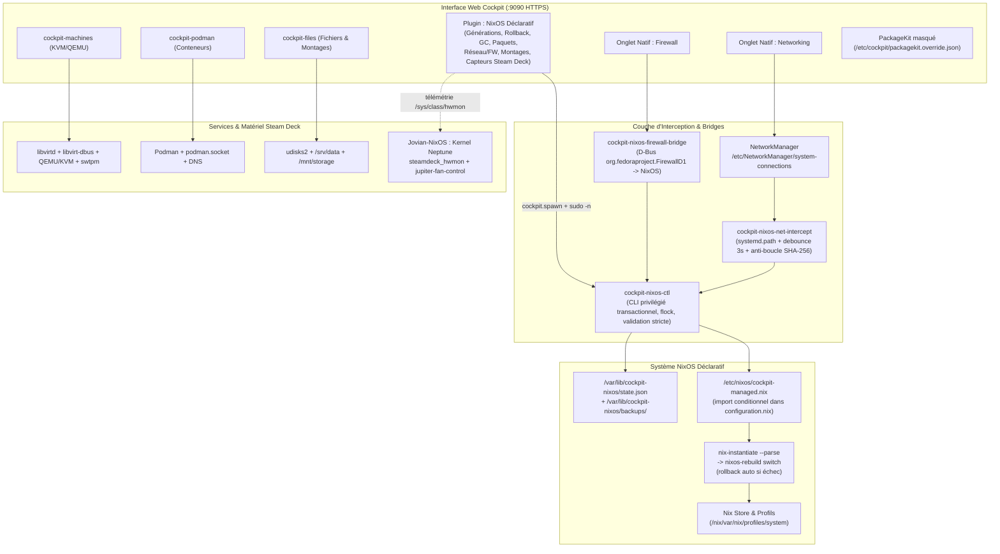

# Cockpit-NixOS — Écosystème Cockpit Natif & Déclaratif pour NixOS (+ Serveur Steam Deck)

Architecture complète, code source frontend/backend et déploiement en **un seul fichier `.nix`** pour exécuter l'ensemble de l'écosystème Cockpit (`cockpit-machines`, `cockpit-files`, `cockpit-podman`, réseau, pare-feu, paquets, générations) de façon **100 % native et déclarative** sur NixOS.

---

## 1. Architecture Globale



### Pourquoi cette architecture résout les frictions Cockpit ↔ NixOS

| Limite classique Cockpit sur NixOS | Solution implémentée |
| :--- | :--- |
| **PackageKit cassé** (pas de backend Nix) | Masqué proprement via `/etc/cockpit/packagekit.override.json` (JSON Merge Patch officiel) et remplacé par l'onglet **Paquets Nix** du plugin `cockpit-nixos`. |
| **Firewalld en conflit** avec `networking.firewall` | On conserve le pare-feu natif NixOS (`nftables`/`iptables`) et notre démon léger `cockpit-nixos-firewall-bridge` expose `org.fedoraproject.FirewallD1` sur D-Bus pour traduire chaque port/service vers `/etc/nixos/cockpit-managed.nix`. |
| **Dérive réseau NetworkManager** | Un watcher `systemd.path` (`cockpit-nixos-net-intercept`) détecte les changements de profils NetworkManager, filtre les interfaces éphémères (`podman*`, `veth*`, `virbr*`), évite les boucles via sentinel + hash SHA-256, et écrit `networking.networkmanager.ensureProfiles.profiles` dans `cockpit-managed.nix`. |
| **Risque de casser NixOS depuis l'UI** | `cockpit-nixos-ctl` valide strictement chaque champ (regex + `ipaddress` + préfixes de montage autorisés), verrouille par `flock`, sauvegarde `cockpit-managed.nix`, vérifie la syntaxe via `nix-instantiate --parse`, et **restaure automatiquement** le backup si `nixos-rebuild switch` échoue. |
| **Découverte des plugins** dans le Nix store | `environment.pathsToLink = [ "/share/cockpit" ];` expose `cockpit-machines`, `cockpit-files`, `cockpit-podman` et notre `nixos-manager` dans `/run/current-system/sw/share/cockpit/`. |
| **Permissions Sudo / Polkit** | `security.sudo.extraRules` n'accorde `NOPASSWD` **que** sur le binaire immuable `cockpit-nixos-ctl` (avec `NOSETENV`), et Polkit limite les autorisations `systemd1`, `NetworkManager`, `udisks2`, `libvirt` et `FirewallD1` au groupe `wheel`. |
| **Ventilateur Steam Deck (`steamdeck_hwmon`)** | Le driver EC `steamdeck_hwmon` est hors-arbre du kernel mainline : import automatique de **Jovian-NixOS** (noyau Valve Neptune + `jupiter-fan-control`) avec mode serveur headless (`jovian.steam.enable = false`, anti-veille, `consoleblank=60` anti burn-in OLED). |
| **Mises à jour auto + Health-Checker (style openSUSE MicroOS)** | `system.autoUpgrade` quotidien avec fenêtre de reboot (`03:00`–`05:30`), protégé par 3 niveaux : **watchdog matériel + `panic=10`**, **`systemd-boot` `bootCounting` + `systemd-bless-boot`** (si dispo), et notre **`nixos-health-checker`** en 3 phases (`nixos-boot-counter` précoce, sondes système avant `boot-complete.target`, et `--live-check` post-upgrade à chaud) déclenchant un **rollback automatique** après 3 démarrages/échecs consécutifs sur une nouvelle génération. |

---

## 2. Arborescence du Projet (prêt pour GitHub)

```text
NixOS Server/
├── default.nix                             # Point d'entrée GitHub (importe profiles/steamdeck-server.nix)
├── flake.nix                               # Export Flakes (nixosModules.default & nixosModules.cockpit-nixos)
├── profiles/
│   └── steamdeck-server.nix                # Profil serveur complet (Cockpit + Podman + KVM + Steam Deck + MicroOS HC)
├── deploy/
│   └── steamdeck-server.nix                # Exemple minimal (15 lignes) à copier sur le serveur
├── plugin/                                 # Frontend du plugin Cockpit (CSP strict, zéro JS inline)
│   ├── manifest.json
│   ├── index.html
│   ├── style.css
│   └── app.js
├── backend/                                # Services & CLI Python 3
│   ├── cockpit-nixos-ctl.py                # CLI transactionnel (générations, rollback, GC, state -> Nix)
│   ├── cockpit-nixos-net-intercept.py      # Intercepteur NetworkManager -> cockpit-managed.nix
│   ├── cockpit-nixos-firewall-bridge.py    # Bridge D-Bus FirewallD1 -> networking.firewall
│   └── nixos-health-checker.py             # Health-checker boot & auto-rollback (style openSUSE MicroOS)
└── nixos/                                  # Module générique réutilisable (hors Steam Deck)
    ├── cockpit-nixos-module.nix            # Module réutilisable (services.cockpit-nixos.*)
    └── configuration.nix                   # Exemple complet de /etc/nixos/configuration.nix
```

---

## 3. Déploiement Express depuis GitHub (1 ligne dans `configuration.nix`)

### Étape 1 — Pousser le projet sur le dépôt GitHub
```bash
cd "/home/benjamin/Documents/NixOS Server"
git init -b main
git add .
git commit -m "Initial commit: NixOS Steam Deck Server + Cockpit Déclaratif + MicroOS Health-Checker"
git remote add origin https://github.com/benjamin7490/nixos-steamdeck-cockpit.git
git push -u origin main
```

### Étape 2 — Sur le Steam Deck : passer sur `nixos-unstable`
```bash
sudo nix-channel --add https://nixos.org/channels/nixos-unstable nixos
sudo nix-channel --update
```

### Étape 3 — Importer directement votre dépôt GitHub dans `/etc/nixos/configuration.nix`
Ajoutez simplement **une seule ligne** dans `imports` de votre `/etc/nixos/configuration.nix` :

```nix
{ config, pkgs, ... }:
{
  imports = [
    ./hardware-configuration.nix
    (builtins.fetchTarball "https://github.com/benjamin7490/nixos-steamdeck-cockpit/archive/main.tar.gz")
  ];

  # Optionnel : donner automatiquement les groupes admin Cockpit à votre utilisateur
  services.steamdeck-server.adminUsers = [ "benjamin" ];

  # Optionnel : courbe ventilateur serveur plus fraîche (sinon jupiter-fan-control de Valve)
  # services.steamdeck-server.enableCustomFanCurve = true;
}
```
*(Pour un serveur NixOS classique **sans** drivers Steam Deck / Jovian, importez plutôt `((builtins.fetchTarball "https://github.com/benjamin7490/nixos-steamdeck-cockpit/archive/main.tar.gz") + "/nixos/cockpit-nixos-module.nix")`.)*

### Étape 4 — Déployer et redémarrer sur le noyau Steam Deck Neptune
```bash
sudo nixos-rebuild switch
sudo reboot
```
> Chaque nuit à `03:30`, `system.autoUpgrade` tirera automatiquement vos derniers commits depuis GitHub + les mises à jour NixOS, testera le démarrage via `nixos-health-checker`, et effectuera un rollback automatique si quelque chose échoue.

### Étape 5 — Vérifier & Ouvrir Cockpit
```bash
# Vérifier les services, le health-checker, les MAJ auto et le ventilateur Steam Deck
systemctl status cockpit.socket podman.socket libvirtd jupiter-fan-control cockpit-nixos-firewall-bridge nixos-health-checker nixos-upgrade.timer
sudo nixos-health-checker --check-only
sensors | grep -A5 steamdeck_hwmon
```
Accédez ensuite depuis votre navigateur à :
`https://<IP-OU-HOSTNAME-DE-VOTRE-SERVEUR>:9090`

Connectez-vous avec votre compte NixOS, cliquez sur **« Activer l'accès administrateur »** dans la barre supérieure, et ouvrez l'onglet **NixOS Déclaratif**.

---

## 4. Fonctionnement du Health-Checker & Auto-Rollback (style openSUSE MicroOS)

1. **Mises à jour automatiques (`system.autoUpgrade`)** : chaque nuit à `03:30` (+ jitter aléatoire de 30 min), le système met à jour le canal NixOS et construit la nouvelle génération. Si le noyau/initrd/systemd change, le serveur redémarre automatiquement uniquement dans la fenêtre `03:00`–`05:30` ; sinon la bascule se fait à chaud. Un `nix.gc` hebdomadaire nettoie les générations de plus de 14 jours afin de toujours conserver un point de rollback valide.
2. **Protection contre les Kernel Panics / Freezes** : `boot.kernelParams = [ "panic=10" "oops=panic" ]` + Watchdog matériel (`RuntimeWatchdogSec = 30s`, `RebootWatchdogSec = 2min`) forcent le redémarrage si le système se fige. Si `systemd-boot` dispose de `bootCounting` sur votre canal NixOS, le compteur natif EFI `+3` + `systemd-bless-boot` est activé automatiquement.
3. **Compteur précoce (`nixos-boot-counter.service`)** : exécuté dès `local-fs.target`, incrémente de façon atomique (`fsync`) le compteur de tentatives dans `/var/lib/nixos-health-checker/state.json` dès qu'une génération diffère de `last_good_gen`. Si le serveur redémarre en boucle plus de **3 fois** (`maxBootAttempts = 3`), il bascule immédiatement sur `last_good_gen` et met à jour le bootloader (compatible `systemd-boot` **et** `GRUB`).
4. **Sondes de santé complètes (`nixos-health-checker.service`, bloquant `boot-complete.target`)** : vérifie le système de fichiers en lecture-écriture, les services critiques (`dbus`, `NetworkManager`, `cockpit.socket`, `sshd`, `podman.socket`, `libvirtd`), la présence d'une IP LAN, l'écoute du port Cockpit `9090` et l'absence de surchauffe (`< 95 °C`).
   - **Succès** → enregistre `last_good_gen`, remet le compteur à `0` et atteint `boot-complete.target` (bénédiction du boot).
   - **Échec sur une nouvelle génération** → retente après reboot jusqu'à 3 fois, puis **rollback atomique automatique** vers `last_good_gen` et mise en liste noire de la génération cassée.
   - **Garde-fou anti-boucle** → si le serveur tourne déjà sur `last_good_gen` (ex. box Internet débranchée), il passe en état `DEGRADED_ON_LAST_GOOD` sans jamais déclencher de rollback infini.
5. **Post-upgrade à chaud (`--live-check`)** : lorsqu'une mise à jour auto s'applique sans reboot, les sondes s'exécutent immédiatement en `ExecStartPost` et lancent `nixos-rebuild switch --rollback` en cas d'anomalie.

---

## 4. Déploiement Modulaire (Alternative Git / Développement)

Si vous souhaitez faire évoluer le plugin séparément :
```bash
sudo mkdir -p /etc/nixos/cockpit-nixos
sudo cp -r plugin backend nixos/cockpit-nixos-module.nix /etc/nixos/cockpit-nixos/
```
Puis importez `/etc/nixos/cockpit-nixos/cockpit-nixos-module.nix` (et conditionnellement `/etc/nixos/cockpit-managed.nix`) dans votre `/etc/nixos/configuration.nix` en vous basant sur `nixos/configuration.nix`.
