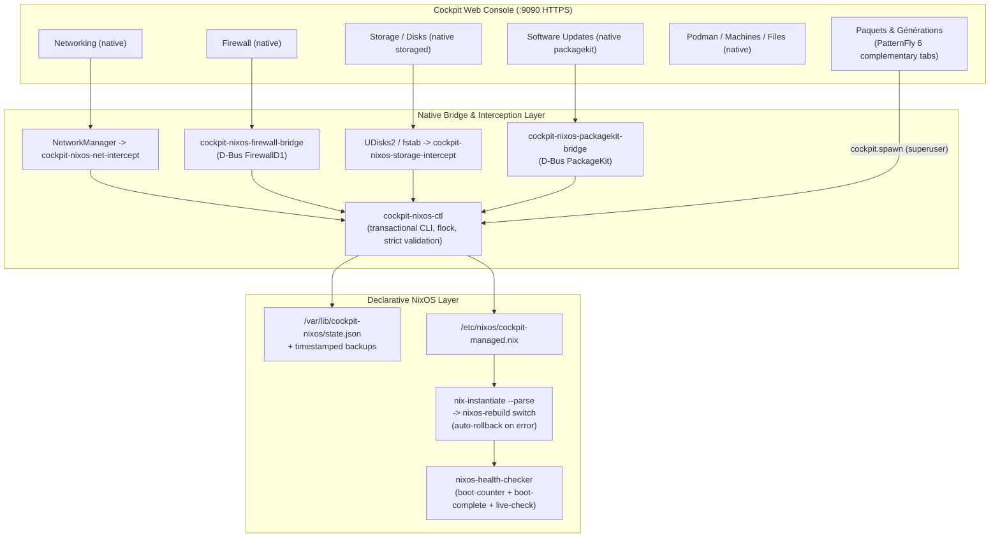

# nixos-steamdeck-cockpit


A NixOS module and **Cockpit** integration that make Cockpit's **real built-in modules** (**Software Updates**, **Storage**, **Networking & Firewall**, **Podman**, **Virtual Machines**, and **Files**) work **natively and declaratively** on NixOS by bridging every UI action into `/etc/nixos/cockpit-managed.nix` — paired with an **openSUSE MicroOS–style boot health checker with automatic rollback** and a turnkey headless server profile for the **Steam Deck** (or any NixOS server).

---

## Features

- **Real Native Cockpit Modules — Adapted Declaratively to NixOS**:
  - **Software Updates (`/updates`, MicroOS `cockpit-tukit` style)**: implements Cockpit's official `"name": "updates"` slot (`priority: 10`, with native `page_status` reporting directly onto Cockpit's *Overview* page), combining NixOS update checks (`nix-channel --update` + `nix store diff-closures`), transactional upgrades (`nixos-rebuild switch --upgrade` + kernel reboot detection), atomic **NixOS Generations & Rollbacks**, **`nix-collect-garbage -d`**, Nix store optimization, and a collapsible `/etc/nixos/cockpit-managed.nix` preview — backed by an `org.freedesktop.PackageKit` D-Bus bridge for full PackageKit compatibility.
  - **Storage (`pkg/storaged` / `udisks2`)**: enables `udisks2`, `smartd` (skipped cleanly in VMs via `ConditionVirtualization=!vm`), and the full disk/filesystem toolset (`parted`, `e2fsprogs`, `btrfs-progs`, `xfsprogs`, `dosfstools`, `ntfs3g`, `cryptsetup`, `lvm2`, `mdadm`, `nfs-utils`, `cifs-utils`). Keeps `/etc/fstab` writable (`mode = "0644"`) for `cockpit-storaged` and intercepts mounts under `/mnt/`, `/srv/`, `/media/`, and `/data/` into declarative `fileSystems` entries in `/etc/nixos/cockpit-managed.nix` (preserving static NixOS mounts).
  - **Networking (`pkg/networkmanager`)**: watches `NetworkManager` profile edits and syncs them into `networking.networkmanager.ensureProfiles.profiles` (3 s debounce, SHA-256 anti-loop guard, ephemeral Podman/Libvirt/veth filtering).
  - **Firewall (native *Networking → Firewall* UI)**: registers a full `org.fedoraproject.FirewallD1` D-Bus bridge (aliased as `firewalld.service`) translating Cockpit's Firewall UI directly into NixOS's native `networking.firewall` without running imperative `firewalld`.
  - **Podman, KVM & Files**: turnkey `cockpit-podman` (`dockerCompat`, `dockerSocket`, internal DNS, weekly `autoPrune`), `cockpit-machines` (`libvirtd`, `libvirt-dbus`, `virt-manager`, `swtpm`), and `cockpit-files` (`/srv/data`, `/srv/shares`, `/mnt/storage`).
- **Declarative Package Manager (`Paquets` Tab, Exact Cockpit PatternFly 6 CSS + Light/Dark Sync)**:
  - Search `nixpkgs` and add/remove packages declaratively in `environment.systemPackages` (`/etc/nixos/cockpit-managed.nix`), linked directly to the native **Software Updates (`/updates`)** tab.
- **Automatic Upgrades & Background Boot Health-Checker (openSUSE MicroOS–style)**:
  - Nightly `system.autoUpgrade` with a configurable reboot window (`03:00`–`05:30`) and weekly `nix.gc` retaining the last 14 days of generations.
  - Pure background systemd protection (no extra UI clutter; inspect logs natively in Cockpit *Logs* / *Services* or `journalctl -u nixos-health-checker`): hardware watchdog + `panic=10`, native `systemd-boot` `bootCounting` (when available in `nixpkgs`), early boot-loop counter, and health probes gating `boot-complete.target`. Repeated boot failures on a new generation trigger an **automatic rollback** to the last known-good generation.
- **Minimal Steam Deck Headless Server Profile (via Jovian-NixOS)**:
  - Pulls **only** Valve's Neptune kernel (`steamdeck` / `steamdeck_hwmon`), `jupiter-fan-control` (plus an optional 24/7 server fan curve daemon), and Holo Wi-Fi/APU firmware — explicitly skipping desktop bloat (no PipeWire, WirePlumber, `steamdeck-dsp`, custom 32/64-bit Mesa, Xorg, or `fwupd` builds).
  - Headless tuning: Steam/Gamescope disabled, sleep/suspend disabled, `consoleblank=60` + DPMS powerdown + automatic backlight/panel power-off after 60 s (`steamdeck-screen on|off` helper), plus optional kernel-level display disable (`video=eDP-1:d`) for zero light & zero OLED burn-in.

---

## Quick Start

### Recommended Channel
Track **`nixos-unstable`** (recommended for `Jovian-NixOS` and `cockpit-files`):
```bash
sudo nix-channel --add https://nixos.org/channels/nixos-unstable nixos
sudo nix-channel --update
```

### Option A — Turnkey Steam Deck Server (1 line in `configuration.nix`)

Add the repository import to your existing `/etc/nixos/configuration.nix`:

```nix
{ config, pkgs, ... }:

{
  imports = [
    ./hardware-configuration.nix
    (builtins.fetchTarball "https://github.com/benjamin7490/nixos-steamdeck-cockpit/archive/main.tar.gz")
  ];

  # Automatically add wheel, networkmanager, and libvirtd groups to your user
  services.steamdeck-server.adminUsers = [ "<your-username>" ];

  # Optional: enable SSH access
  # services.openssh.enable = true;

  # Optional: replace Valve's jupiter-fan-control with a cooler 24/7 server fan curve
  # services.steamdeck-server.enableCustomFanCurve = true;
}
```

Apply and reboot once to boot into Valve's Neptune kernel (`steamdeck_hwmon`):
```bash
sudo nixos-rebuild switch
sudo reboot
```

### Option B — Generic NixOS Server (without Steam Deck / Jovian drivers)

Import only the standalone module `nixos/cockpit-nixos-module.nix`:

```nix
{ config, pkgs, lib, ... }:

{
  imports = [
    ./hardware-configuration.nix
    ((builtins.fetchTarball "https://github.com/benjamin7490/nixos-steamdeck-cockpit/archive/main.tar.gz") + "/nixos/cockpit-nixos-module.nix")
  ] ++ lib.optional (builtins.pathExists /etc/nixos/cockpit-managed.nix) /etc/nixos/cockpit-managed.nix;

  services.cockpit-nixos.enable = true;

  users.users.<your-username>.extraGroups = [ "wheel" "networkmanager" "libvirtd" ];
}
```

### Option C — Nix Flakes

```nix
{
  inputs = {
    nixpkgs.url = "github:NixOS/nixpkgs/nixos-unstable";
    nixos-steamdeck-cockpit.url = "github:benjamin7490/nixos-steamdeck-cockpit";
  };

  outputs = { nixpkgs, nixos-steamdeck-cockpit, ... }: {
    nixosConfigurations.my-server = nixpkgs.lib.nixosSystem {
      system = "x86_64-linux";
      modules = [
        ./configuration.nix
        # Generic module (pure flake):
        nixos-steamdeck-cockpit.nixosModules.cockpit-nixos
        # Or full Steam Deck profile: nixos-steamdeck-cockpit.nixosModules.default
      ];
    };
  };
}
```

### Accessing Cockpit
Open `https://<SERVER-IP-OR-HOSTNAME>:9090` (or `https://localhost:9090` over an SSH tunnel), sign in with your NixOS user account, and click **Turn on administrative access** in the top banner. Use the native **Storage**, **Networking**, **Software Updates**, **Podman**, **Virtual Machines**, and **Files** tabs directly, plus **Paquets** and **Générations** for NixOS-specific management.

---

## Configuration Options

All profile defaults use `lib.mkDefault`, so any setting can be overridden directly in `/etc/nixos/configuration.nix` without `lib.mkForce`.

| Option | Default | Description |
| :--- | :--- | :--- |
| `services.cockpit-nixos.enable` | `true` *(profile)* / `false` *(module)* | Enable Cockpit and the declarative NixOS bridges |
| `services.cockpit-nixos.port` | `9090` | Cockpit HTTPS TCP port |
| `services.cockpit-nixos.allowedOrigins` | `[ ]` | Extra allowed origins (`WebService.Origins`) for reverse proxies |
| `services.cockpit-nixos.enableMachines` | `true` | Enable `cockpit-machines` + KVM/QEMU + `libvirtd` + `libvirt-dbus` |
| `services.cockpit-nixos.enablePodman` | `true` | Enable `cockpit-podman` + Podman + `dockerCompat` + `dockerSocket` |
| `services.cockpit-nixos.enableFiles` | `true` | Enable native Storage (`cockpit-storaged` + `udisks2` + `smartd` + FS tools) & `cockpit-files` |
| `services.cockpit-nixos.enableStorageInterception` | `true` | Sync Storage (`udisks2`/`/etc/fstab`/mountinfo) changes into `/etc/nixos/cockpit-managed.nix` |
| `services.cockpit-nixos.enableNetworkInterception` | `true` | Sync NetworkManager changes into `/etc/nixos/cockpit-managed.nix` |
| `services.cockpit-nixos.enableFirewallBridge` | `true` | D-Bus bridge `org.fedoraproject.FirewallD1` → `networking.firewall` |
| `services.cockpit-nixos.enablePackageKitBridge` | `true` | D-Bus bridge `org.freedesktop.PackageKit` → native *Software Updates* on NixOS |
| `services.cockpit-nixos.enableAutoUpgrade` | `true` | Enable `system.autoUpgrade` + weekly `nix.gc` (14-day retention) |
| `services.cockpit-nixos.autoUpgradeDates` | `"03:30"` | systemd `OnCalendar` schedule for automatic upgrades |
| `services.cockpit-nixos.autoUpgradeRebootWindow` | `{ lower = "03:00"; upper = "05:30"; }` | Allowed time window for automatic reboots |
| `services.cockpit-nixos.enableHealthChecker` | `true` | Enable boot health-checker and automatic rollback |
| `services.cockpit-nixos.maxBootAttempts` | `3` | Maximum failed boot attempts before automatic rollback |
| `services.steamdeck-server.adminUsers` | `[ ]` | Existing users to grant `wheel`, `networkmanager` (and `libvirtd`) |
| `services.steamdeck-server.enableCustomFanCurve` | `false` | Replace `jupiter-fan-control` with a custom 24/7 server fan curve |
| `services.steamdeck-server.screenAutoOff` | `true` | Enable DPMS powerdown and cut backlight/panel power 60 s after boot |
| `services.steamdeck-server.disableInternalDisplay` | `false` | Disable internal `eDP-1` panel at kernel level (`video=eDP-1:d`) |

---

## Architecture



---

## Auto-Upgrade & MicroOS-Style Health-Checker

1. **Hardware & Early Boot Protection**: sets `panic=10 oops=panic`, enables the systemd hardware watchdog (`RuntimeWatchdogSec = 30s`, `RebootWatchdogSec = 2min`), enables native `systemd-boot` `bootCounting` (when supported by `nixpkgs`), and runs an early `nixos-boot-counter.service` at `local-fs.target` (compatible with both `systemd-boot` and `GRUB`) using durable `fsync` writes.
2. **System Health Probes (`nixos-health-checker.service`, required by `boot-complete.target`)**: verifies root/store writability, critical systemd units (`dbus`, `NetworkManager`, `cockpit.socket`, `sshd`, `podman.socket`, `libvirtd`), active LAN IP connectivity, Cockpit TCP port responsiveness, and thermal safety (`< 95 °C`).
   - **Healthy** → records `last_good_gen`, resets the boot attempt counter to `0`, and allows `boot-complete.target` (blessing the boot entry).
   - **Unhealthy on a new generation** → retries up to `maxBootAttempts`, then performs an **automatic atomic rollback** (`nix-env --switch-generation` + `switch-to-configuration boot` + reboot) and blacklists the broken generation.
   - **Anti-loop safeguard** → if already running `last_good_gen` (e.g., an external router outage), reports `DEGRADED_ON_LAST_GOOD` without triggering an infinite rollback loop.
3. **Live Post-Upgrade Check (`--live-check`)**: hooked via `ExecStartPost` on `nixos-upgrade.service` (automatically skipped if a kernel/initrd reboot is pending or in progress) to catch userspace regressions immediately and roll back live.

---

## Security Model

- **Strict input validation**: every package attribute, port, interface, IP address, hostname, and mount point (restricted to `/mnt/`, `/srv/`, `/media/`, `/data/`, `/var/lib/libvirt/images`, `/var/lib/containers`) is validated against strict allowlists prior to generating Nix code. Wi-Fi profiles (`802-11-wireless`) are intentionally excluded from NetworkManager sync so plaintext PSKs are never written to `/etc/nixos/cockpit-managed.nix`.
- **Atomic transactions**: protected by `flock`, backed up before mutation, syntax-checked with `nix-instantiate --parse`, and automatically restored if `nixos-rebuild switch` fails.
- **Least privilege**: `security.sudo` restricts `NOPASSWD`/`NOSETENV` strictly to the immutable Nix store binary `cockpit-nixos-ctl`, `security.polkit.extraConfig` scopes privileges to the `wheel` group, and D-Bus policies restrict `FirewallD1` and `PackageKit` mutations to `root` and `wheel`.

---

## Repository Structure

```text
.
├── default.nix                             # fetchTarball entry point (Steam Deck server profile)
├── flake.nix                               # Flake outputs (default, steamdeck-server, cockpit-nixos)
├── profiles/
│   └── steamdeck-server.nix                # Full Steam Deck headless server profile (Jovian + Cockpit + HC)
├── deploy/
│   └── steamdeck-server.nix                # Minimal drop-in snippet for /etc/nixos/
├── nixos/
│   ├── cockpit-nixos-module.nix            # Generic reusable NixOS module (services.cockpit-nixos.*)
│   └── configuration.nix                   # Full reference configuration.nix
├── plugin/                                 # Cockpit frontend (exact Cockpit PatternFly 6 CSS, strict CSP)
│   ├── updates-manifest.json               # Official Cockpit "updates" slot (/updates, priority 10)
│   ├── updates.html                        # MicroOS-style Software Updates, Generations, Rollback & GC
│   ├── packages-manifest.json              # Declarative NixOS Packages sidebar tab
│   ├── packages.html                       # Declarative nixpkgs search & environment.systemPackages UI
│   ├── style.css
│   └── app.js
└── backend/                                # Python 3 CLI, D-Bus bridges & watchers
    ├── cockpit-nixos-ctl.py                # Privileged transactional CLI
    ├── cockpit-nixos-net-intercept.py      # NetworkManager -> NixOS interceptor
    ├── cockpit-nixos-storage-intercept.py  # UDisks2/fstab/mountinfo -> NixOS interceptor
    ├── cockpit-nixos-firewall-bridge.py    # D-Bus FirewallD1 -> networking.firewall bridge
    ├── cockpit-nixos-packagekit-bridge.py  # D-Bus PackageKit -> NixOS Software Updates & packages bridge
    └── nixos-health-checker.py             # MicroOS-style boot health-checker & auto-rollback
```

---

## Useful Diagnostic Commands

```bash
# Check Cockpit and declarative NixOS bridges
systemctl status cockpit.socket udisks2 cockpit-nixos-firewall-bridge cockpit-nixos-packagekit-bridge cockpit-nixos-storage-intercept nixos-health-checker nixos-upgrade.timer

# View full Cockpit web/bridge logs (including dynamic wsinstance units)
journalctl -u 'cockpit*' -n 50 --no-pager

# Run health probes manually
sudo nixos-health-checker --check-only
cat /var/lib/nixos-health-checker/state.json

# Verify Steam Deck fan control & sensors
systemctl status jupiter-fan-control
sensors | grep -A5 steamdeck_hwmon
```
