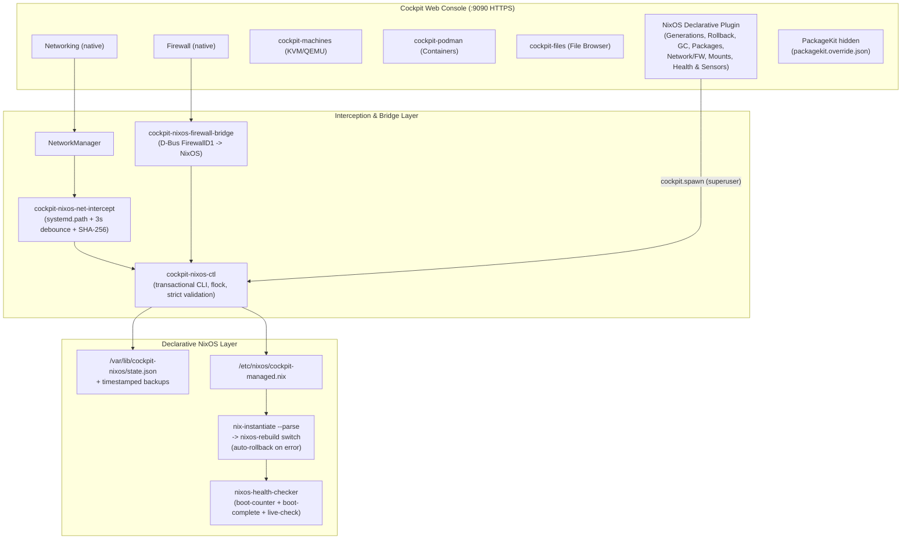

# nixos-steamdeck-cockpit


A NixOS module and **Cockpit** plugin that bring the full Cockpit ecosystem (`cockpit-machines`, `cockpit-files`, `cockpit-podman`, networking, firewall, packages, and generations) to NixOS **natively and declaratively**, paired with an **openSUSE MicroOS–style boot health checker with automatic rollback** and a turnkey headless server profile for the **Steam Deck** (or any NixOS server).

---

## Features

- **Native Cockpit Plugin ("NixOS Déclaratif")** integrated into Cockpit's main navigation:
  - View NixOS system generations, switch generations atomically, **Roll back** with one click, run **`nix-collect-garbage -d`**, and optimize the Nix store (`nix-store --optimise`) with live streamed logs.
  - Declaratively manage **Nix packages** (search `nixpkgs`, add/remove), **firewall rules**, **network settings**, and **`fileSystems` mounts** for `cockpit-files`.
  - Live dashboard for **Health-Checker** status, automatic upgrades, and **`hwmon` hardware telemetry** (Steam Deck fan RPM & APU temperature).
- **Declarative Interception into `/etc/nixos/cockpit-managed.nix`**:
  - **Networking**: watches changes made through Cockpit's native *Networking* UI (`NetworkManager`) and syncs persistent profiles into `networking.networkmanager.ensureProfiles.profiles` (with 3 s debounce, SHA-256 anti-loop guard, and automatic filtering of ephemeral Podman/Libvirt/veth interfaces).
  - **Firewall**: exposes a lightweight D-Bus bridge (`org.fedoraproject.FirewallD1`) so Cockpit's *Firewall* UI works seamlessly while keeping NixOS's native declarative firewall (`networking.firewall`).
  - **Packages**: hides the incompatible `PackageKit` tab via `override.json` and routes all package changes into `environment.systemPackages`.
- **Full Virtualization, Containers & Storage Stack**:
  - **Podman** (`cockpit-podman`, `dockerCompat`, `dockerSocket`, internal DNS, `podman-compose`, weekly `autoPrune`).
  - **KVM / QEMU** (`cockpit-machines`, `libvirtd`, `libvirt-dbus`, `virt-manager`, `swtpm`).
  - **Files & Disks** (`cockpit-files`, `udisks2`, pre-configured `/srv/data`, `/srv/shares`, `/mnt/storage` directories).
- **Automatic Upgrades & Boot Health-Checker (openSUSE MicroOS–style)**:
  - Nightly `system.autoUpgrade` with a configurable reboot window (`03:00`–`05:30`) and weekly `nix.gc` retaining the last 14 days of generations.
  - Three-layer protection: hardware watchdog + `panic=10`, native `systemd-boot` `bootCounting` (when available in `nixpkgs`), early boot-loop counter, and health probes gating `boot-complete.target`. Repeated boot failures on a new generation trigger an **automatic rollback** to the last known-good generation.
- **Steam Deck Headless Server Profile (via Jovian-NixOS)**:
  - Valve Neptune kernel with `steamdeck` / `steamdeck_hwmon` drivers and `jupiter-fan-control` (plus an optional 24/7 server fan curve daemon).
  - Headless tuning: Steam/Gamescope disabled, sleep/suspend disabled, and `consoleblank=60` for OLED burn-in protection.

---

## Quick Start

### Recommended Channel
Track **`nixos-unstable`** (recommended for `Jovian-NixOS` and `cockpit-files`):
```bash
sudo nix-channel --add https://nixos.org/channels/nixos-unstable nixos
sudo nix-channel --update
```

### Option A — Turnkey Steam Deck Server (1 line in `configuration.nix`)

Add the repository import to your existing `/etc/nixos/configuration.nix`:

```nix
{ config, pkgs, ... }:

{
  imports = [
    ./hardware-configuration.nix
    (builtins.fetchTarball "https://github.com/benjamin7490/nixos-steamdeck-cockpit/archive/main.tar.gz")
  ];

  # Automatically add wheel, networkmanager, and libvirtd groups to your user
  services.steamdeck-server.adminUsers = [ "<your-username>" ];

  # Optional: enable SSH access
  # services.openssh.enable = true;

  # Optional: replace Valve's jupiter-fan-control with a cooler 24/7 server fan curve
  # services.steamdeck-server.enableCustomFanCurve = true;
}
```

Apply and reboot once to boot into Valve's Neptune kernel (`steamdeck_hwmon`):
```bash
sudo nixos-rebuild switch
sudo reboot
```

### Option B — Generic NixOS Server (without Steam Deck / Jovian drivers)

Import only the standalone module `nixos/cockpit-nixos-module.nix`:

```nix
{ config, pkgs, lib, ... }:

{
  imports = [
    ./hardware-configuration.nix
    ((builtins.fetchTarball "https://github.com/benjamin7490/nixos-steamdeck-cockpit/archive/main.tar.gz") + "/nixos/cockpit-nixos-module.nix")
  ] ++ lib.optional (builtins.pathExists /etc/nixos/cockpit-managed.nix) /etc/nixos/cockpit-managed.nix;

  services.cockpit-nixos.enable = true;

  users.users.<your-username>.extraGroups = [ "wheel" "networkmanager" "libvirtd" ];
}
```

### Option C — Nix Flakes

```nix
{
  inputs = {
    nixpkgs.url = "github:NixOS/nixpkgs/nixos-unstable";
    nixos-steamdeck-cockpit.url = "github:benjamin7490/nixos-steamdeck-cockpit";
  };

  outputs = { nixpkgs, nixos-steamdeck-cockpit, ... }: {
    nixosConfigurations.my-server = nixpkgs.lib.nixosSystem {
      system = "x86_64-linux";
      modules = [
        ./configuration.nix
        # Generic module (pure flake):
        nixos-steamdeck-cockpit.nixosModules.cockpit-nixos
        # Or full Steam Deck profile: nixos-steamdeck-cockpit.nixosModules.default
      ];
    };
  };
}
```

### Accessing Cockpit
Open `https://<SERVER-IP-OR-HOSTNAME>:9090` in your browser, sign in with your NixOS user account, click **Turn on administrative access** in the top banner, and navigate to **NixOS Déclaratif**.

---

## Configuration Options

All profile defaults use `lib.mkDefault`, so any setting can be overridden directly in `/etc/nixos/configuration.nix` without `lib.mkForce`.

| Option | Default | Description |
| :--- | :--- | :--- |
| `services.cockpit-nixos.enable` | `true` *(profile)* / `false` *(module)* | Enable Cockpit and the declarative NixOS bridge |
| `services.cockpit-nixos.port` | `9090` | Cockpit HTTPS TCP port |
| `services.cockpit-nixos.allowedOrigins` | `[ ]` | Extra allowed origins (`WebService.Origins`) for reverse proxies |
| `services.cockpit-nixos.enableMachines` | `true` | Enable `cockpit-machines` + KVM/QEMU + `libvirtd` + `libvirt-dbus` |
| `services.cockpit-nixos.enablePodman` | `true` | Enable `cockpit-podman` + Podman + `dockerCompat` + `dockerSocket` |
| `services.cockpit-nixos.enableFiles` | `true` | Enable `cockpit-files` + `udisks2` + `/srv` & `/mnt` directories |
| `services.cockpit-nixos.enableNetworkInterception` | `true` | Sync NetworkManager changes into `/etc/nixos/cockpit-managed.nix` |
| `services.cockpit-nixos.enableFirewallBridge` | `true` | D-Bus bridge `org.fedoraproject.FirewallD1` → `networking.firewall` |
| `services.cockpit-nixos.enableAutoUpgrade` | `true` | Enable `system.autoUpgrade` + weekly `nix.gc` (14-day retention) |
| `services.cockpit-nixos.autoUpgradeDates` | `"03:30"` | systemd `OnCalendar` schedule for automatic upgrades |
| `services.cockpit-nixos.autoUpgradeRebootWindow` | `{ lower = "03:00"; upper = "05:30"; }` | Allowed time window for automatic reboots |
| `services.cockpit-nixos.enableHealthChecker` | `true` | Enable boot health-checker and automatic rollback |
| `services.cockpit-nixos.maxBootAttempts` | `3` | Maximum failed boot attempts before automatic rollback |
| `services.steamdeck-server.adminUsers` | `[ ]` | Existing users to grant `wheel`, `networkmanager` (and `libvirtd`) |
| `services.steamdeck-server.enableCustomFanCurve` | `false` | Replace `jupiter-fan-control` with a custom 24/7 server fan curve |

---

## Architecture



---

## Auto-Upgrade & MicroOS-Style Health-Checker

1. **Hardware & Early Boot Protection**: sets `panic=10 oops=panic`, enables the systemd hardware watchdog (`RuntimeWatchdogSec = 30s`, `RebootWatchdogSec = 2min`), enables native `systemd-boot` `bootCounting` (when supported by `nixpkgs`), and runs an early `nixos-boot-counter.service` at `local-fs.target` (compatible with both `systemd-boot` and `GRUB`) using durable `fsync` writes.
2. **System Health Probes (`nixos-health-checker.service`, required by `boot-complete.target`)**: verifies root/store writability, critical systemd units (`dbus`, `NetworkManager`, `cockpit.socket`, `sshd`, `podman.socket`, `libvirtd`), active LAN IP connectivity, Cockpit TCP port responsiveness, and thermal safety (`< 95 °C`).
   - **Healthy** → records `last_good_gen`, resets the boot attempt counter to `0`, and allows `boot-complete.target` (blessing the boot entry).
   - **Unhealthy on a new generation** → retries up to `maxBootAttempts`, then performs an **automatic atomic rollback** (`nix-env --switch-generation` + `switch-to-configuration boot` + reboot) and blacklists the broken generation.
   - **Anti-loop safeguard** → if already running `last_good_gen` (e.g., an external router outage), reports `DEGRADED_ON_LAST_GOOD` without triggering an infinite rollback loop.
3. **Live Post-Upgrade Check (`--live-check`)**: hooked via `ExecStartPost` on `nixos-upgrade.service` (automatically skipped if a kernel/initrd reboot is pending or in progress) to catch userspace regressions immediately and roll back live.

---

## Security Model

- **Strict input validation**: every package attribute, port, interface, IP address, hostname, and mount point (restricted to `/mnt/`, `/srv/`, `/media/`, `/data/`, `/var/lib/libvirt/images`, `/var/lib/containers`) is validated against strict allowlists prior to generating Nix code. Wi-Fi profiles (`802-11-wireless`) are intentionally excluded from NetworkManager sync so plaintext PSKs are never written to `/etc/nixos/cockpit-managed.nix`.
- **Atomic transactions**: protected by `flock`, backed up before mutation, syntax-checked with `nix-instantiate --parse`, and automatically restored if `nixos-rebuild switch` fails.
- **Least privilege**: `security.sudo` restricts `NOPASSWD`/`NOSETENV` strictly to the immutable Nix store binary `cockpit-nixos-ctl`, `security.polkit.extraConfig` scopes privileges to the `wheel` group, and the D-Bus policy denies firewall mutations and `reload` to non-`wheel` users.

---

## Repository Structure

```text
.
├── default.nix                             # fetchTarball entry point (Steam Deck server profile)
├── flake.nix                               # Flake outputs (default, steamdeck-server, cockpit-nixos)
├── profiles/
│   └── steamdeck-server.nix                # Full Steam Deck headless server profile (Jovian + Cockpit + HC)
├── deploy/
│   └── steamdeck-server.nix                # Minimal drop-in snippet for /etc/nixos/
├── nixos/
│   ├── cockpit-nixos-module.nix            # Generic reusable NixOS module (services.cockpit-nixos.*)
│   └── configuration.nix                   # Full reference configuration.nix
├── plugin/                                 # Cockpit frontend (strict CSP, zero inline JS)
│   ├── manifest.json
│   ├── index.html
│   ├── style.css
│   └── app.js
└── backend/                                # Python 3 CLI & background services
    ├── cockpit-nixos-ctl.py                # Privileged transactional CLI
    ├── cockpit-nixos-net-intercept.py      # NetworkManager -> NixOS interceptor
    ├── cockpit-nixos-firewall-bridge.py    # D-Bus FirewallD1 -> networking.firewall bridge
    └── nixos-health-checker.py             # MicroOS-style boot health-checker & auto-rollback
```

---

## Useful Diagnostic Commands

```bash
# Check core services
systemctl status cockpit.socket podman.socket libvirtd cockpit-nixos-firewall-bridge nixos-health-checker nixos-upgrade.timer

# Run health probes manually
sudo nixos-health-checker --check-only
cat /var/lib/nixos-health-checker/state.json

# Verify Steam Deck fan control & sensors
systemctl status jupiter-fan-control
sensors | grep -A5 steamdeck_hwmon
```
